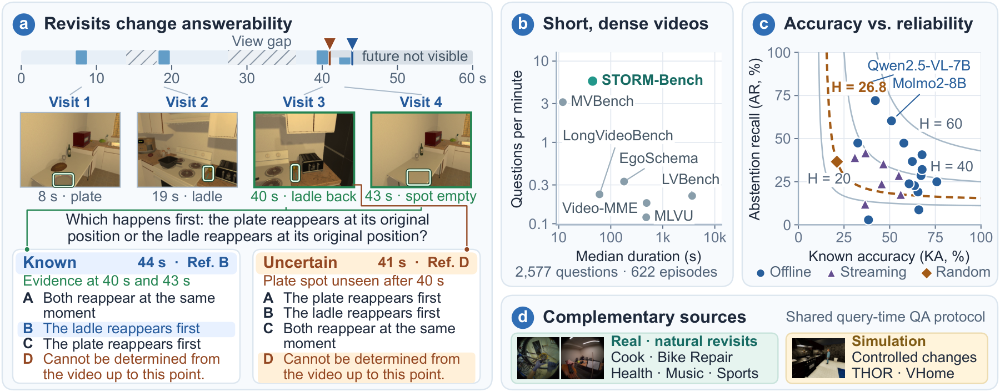
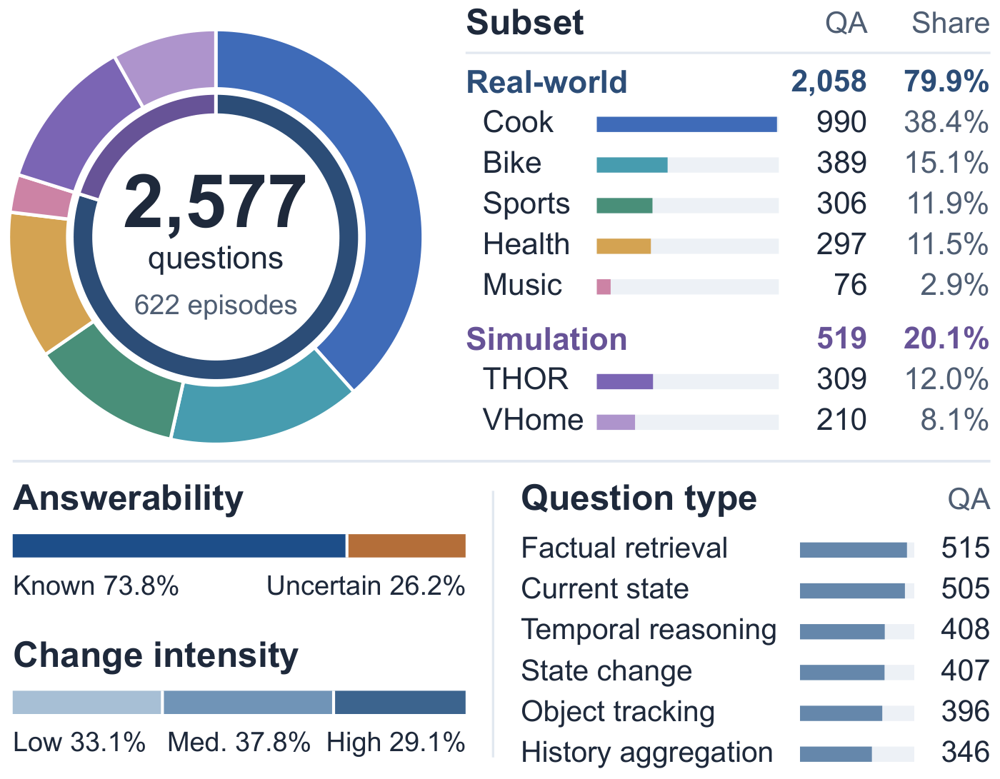
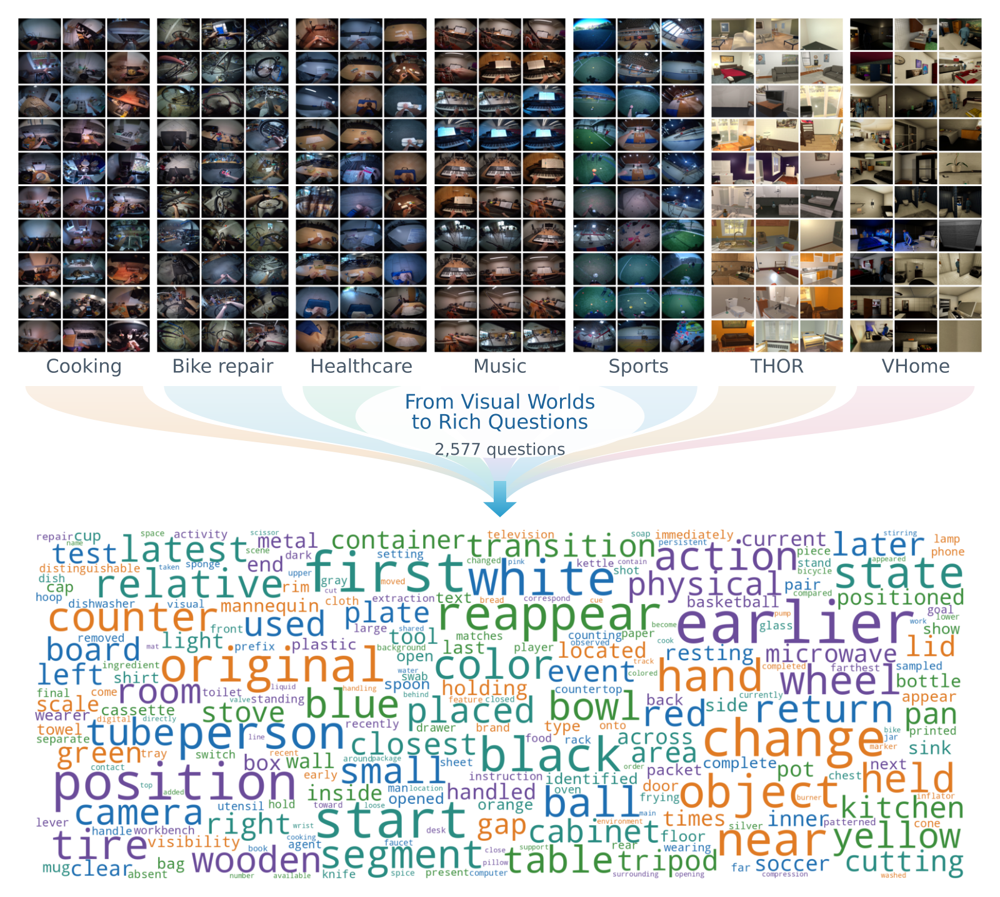
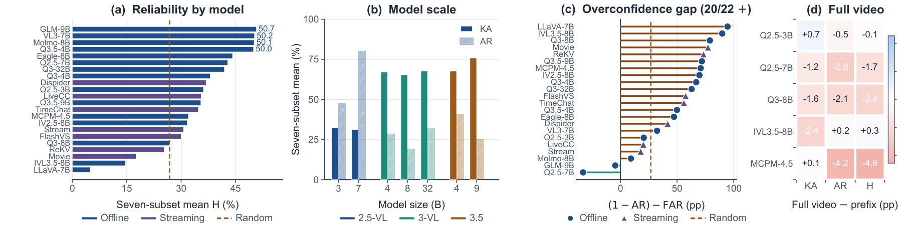
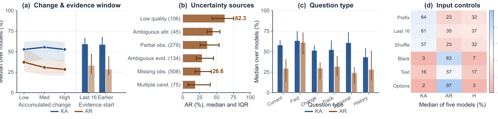
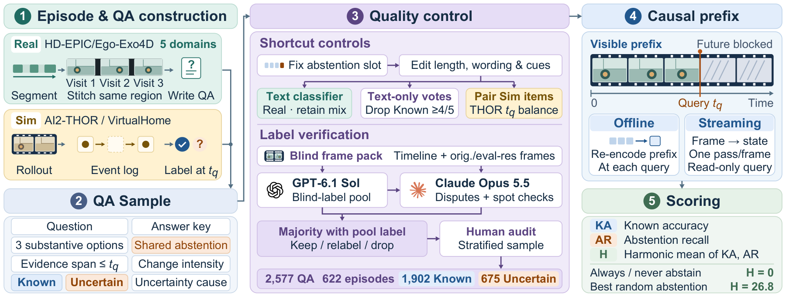
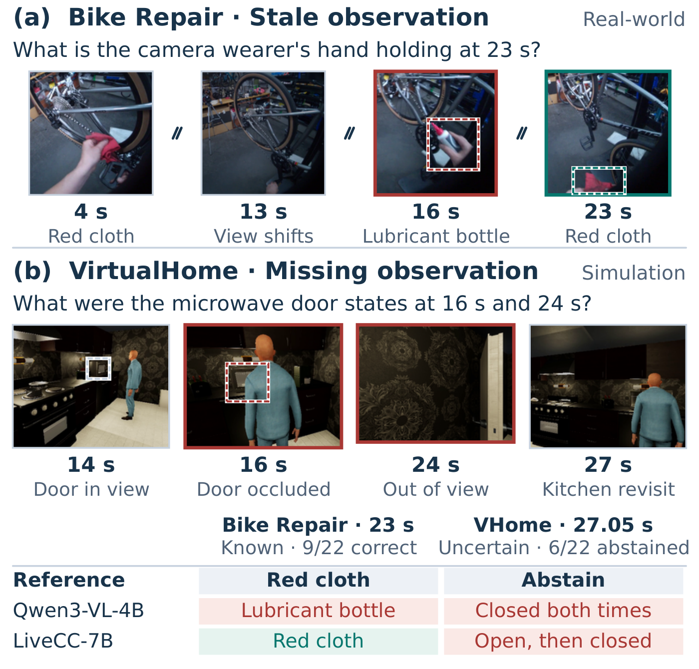
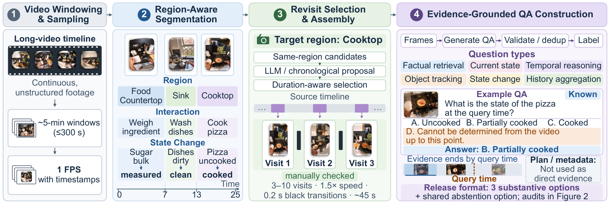
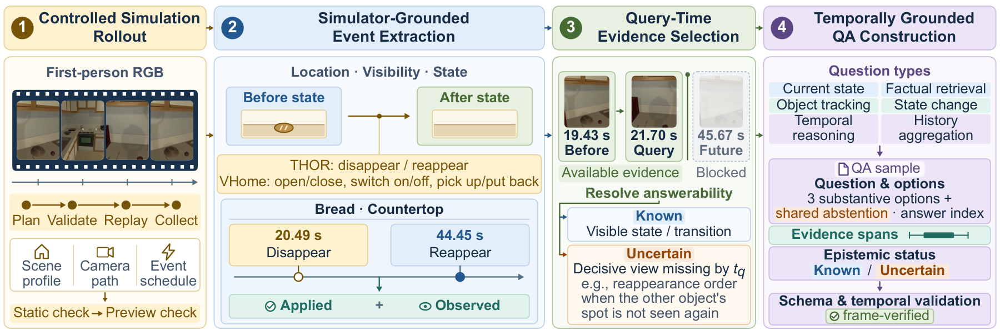

# RevisitQA

**RevisitQA: Short Videos Are Not Easy under Dense Revisits**

[Dataset (Hugging Face)](https://huggingface.co/datasets/siruzhong/RevisitQA) · [Evaluation guide](scripts/eval/README.md) · [Real construction](revisitqa-real/README.md) · [Sim construction](revisitqa-sim/README.md)

Construction pipelines, evaluation code, and small example clips. The full benchmark (JSONL + videos) is on Hugging Face.

RevisitQA studies short videos under dense episodic revisits: when a camera repeatedly leaves and returns to the same workspace, objects may change out of view and earlier observations can go stale. At query time \(t_q\) the model sees only the 1~FPS causal prefix \(V_{\le t_q}\) and must answer from that history or abstain when it is insufficient.

<p align="center">
  
</p>
<p align="center"><em>Overview of the seven-subset benchmark and the KA / AR / H evaluation protocol.</em></p>

## Release snapshot

| Track | Subset | Source | Questions | Episodes |
| --- | --- | --- | ---: | ---: |
| Real | Cook | HD-EPIC | 990 | 307 |
| Real | Bike Repair | Ego-Exo4D | 389 | 61 |
| Real | Health | Ego-Exo4D | 297 | 82 |
| Real | Music | Ego-Exo4D | 76 | 16 |
| Real | Sports | Ego-Exo4D | 306 | 99 |
| Sim | THOR | AI2-THOR | 309 | 28 |
| Sim | VHome | VirtualHome | 210 | 29 |
| **Total** | | | **2,577** | **622** |

Of these, **1,902 Known** and **675 Uncertain** (median duration **44.8 s**; ~7.56 h of video). Questions cover six types (factual retrieval, current state, state change, object tracking, temporal reasoning, history aggregation). Every item has three substantive options plus the shared abstention option:

> Cannot be determined from the video up to this point.

<p align="center">
  
</p>
<p align="center"><em>Domain mix, answerability, change intensity, and question-type composition of the 2,577-item release.</em></p>

<p align="center">
  
</p>
<p align="center"><em>Example frames from all seven subsets and the question vocabulary.</em></p>

## Metrics

Primary ranking uses the harmonic mean \(H\) of answering and abstaining:

- **Known accuracy (KA):** fraction of Known items answered with the correct substantive option (abstaining counts as wrong).
- **Abstention recall (AR):** fraction of Uncertain items on which the model abstains.
- **Harmonic mean \(H\):** \(H = 2\cdot\mathrm{KA}\cdot\mathrm{AR}/(\mathrm{KA}+\mathrm{AR})\). Always-abstain and never-abstain both score \(H=0\). Random abstention chance is \(H=26.8\).

Report KA, AR, and false-abstention rate together. Full protocol and commands: [scripts/eval/README.md](scripts/eval/README.md).

<p align="center">
  
</p>
<p align="center"><em>Positioning against prior video QA suites: compact duration, dense visual change, and dense QA supervision.</em></p>

<p align="center">
  
</p>
<p align="center"><em>Change-intensity and evidence-window trends, uncertainty sources, question types, and input controls.</em></p>

## Quick start (scoring)

Download the HF subset JSONL (or a full local checkout), then score a prediction file (no videos required for scoring):

```bash
pip install -r requirements-eval.txt   # torch optional for pure scoring imports

python scripts/eval/score_revisitqa_predictions.py \
  --gt-file data/eval_video/RevisitQA/revisitqa_bike/bike_question_answer.jsonl \
  --pred-file /path/to/pred.jsonl
```

To remap an older run onto a new output tree:

```bash
python scripts/eval/rescore_revisitqa_subset.py \
  --model qwen3_vl_8b \
  --source outputs/revisitqa/previous \
  --target outputs/revisitqa/released
```

## Quick start (model evaluation)

Model inference needs (1) a local Hugging Face checkout under `data/eval_video/RevisitQA/` (or `REVISITQA_ROOT`), (2) checkpoints under `ckpt/`, and (3) the eval environments:

```bash
BASE_PYTHON=/path/to/torch/python bash scripts/setup_revisitqa_envs.sh

python scripts/eval/run_revisitqa_models.py \
  --models qwen3_vl_8b --protocols online \
  --checkpoint-root ckpt \
  --subsets bike
```

Protocol flags map to the paper as follows: `--protocols online` = causal-prefix \(V_{\le t_q}\); `--protocols offline` = full-video control \(V\). Offline video LLMs and streaming models use separate runners; streaming entry points are `run_revisitqa_streaming_native.py` / `eval_revisitqa_streaming.py`.

## Layout

```text
RevisitQA/
├── data/examples/                   # one demo clip + questions per subset
├── scripts/eval/                    # evaluation (causal-prefix KA / AR / H)
├── scripts/data/                    # abstention unify + label rubric + filters
├── revisitqa-real/                  # real-world construction pipeline
├── revisitqa-sim/                   # THOR / VirtualHome construction
└── docs/assets/                     # paper figures used in this README
```

Full release layout after downloading Hugging Face (gitignored local cache; or set `REVISITQA_ROOT`):

```text
data/eval_video/RevisitQA/<revisitqa_*>/<subset>_question_answer.jsonl
data/eval_video/RevisitQA/<revisitqa_*>/video/
```

## Protocol and failure cases

<p align="center">
  
</p>
<p align="center"><em>Construction, quality control, and evaluation.</em></p>

<p align="center">
  
</p>
<p align="center"><em>Failure cases in real and simulated revisits: stale history and unresolved door states.</em></p>

## Construction

Real episodes stitch revisits to one functional region; simulation episodes use continuous rollouts labeled at \(t_q\). Construction code is under [`revisitqa-real/`](revisitqa-real/) and [`revisitqa-sim/`](revisitqa-sim/). Evaluation uses the Hugging Face JSONL.

<p align="center">
  
</p>
<p align="center"><em>Real-world episode construction.</em></p>

<p align="center">
  
</p>
<p align="center"><em>Simulated episode construction (THOR workflow).</em></p>

## Data download and sources

Full benchmark (JSONL + videos): [siruzhong/RevisitQA](https://huggingface.co/datasets/siruzhong/RevisitQA). Checkout or copy subset folders under `data/eval_video/RevisitQA/` (or set `REVISITQA_ROOT` to the HF root).

Real subsets derive from [HD-EPIC](https://hd-epic.github.io/) and [Ego-Exo4D](https://ego-exo4d-data.org/); simulation subsets use [AI2-THOR](https://ai2thor.allenai.org/) and [VirtualHome](http://virtual-home.org/). Follow the corresponding source licenses. This repository provides construction and evaluation code plus small example clips; full media is on Hugging Face.

## Notes

- Evaluate against the Hugging Face English JSONL.
- Construction helpers may need local rollout or capture roots via `REVISITQA_THOR_ROLLOUT_ROOT` / `REVISITQA_VHOME_RAW_EPISODES`.
- Streaming adapters default to repo-local `.venv-*` interpreters; override by editing the adapter `SPEC.runtime` if needed.
